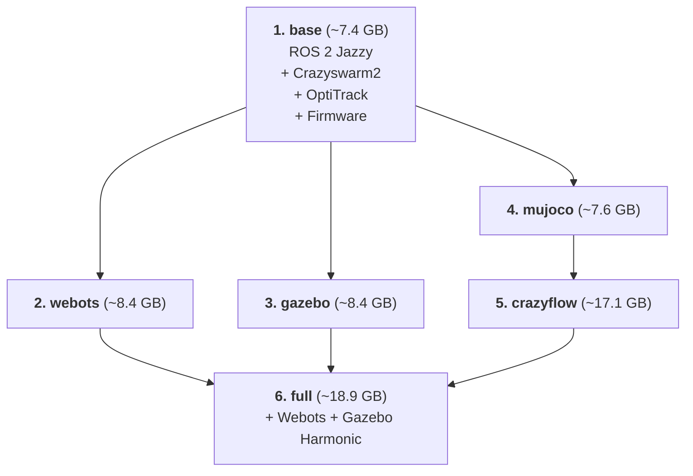

# Docker Multi-Stage & Profiles (Versione Modulare)

Configurazione Docker modulare basata su [Multi-stage builds](https://docs.docker.com/build/building/multi-stage/) e [Docker Compose Profiles](https://docs.docker.com/compose/how-tos/profiles/).  
Permette di costruire e avviare **solo il simulatore necessario**, riducendo tempi di download e spazio su disco rispetto all'immagine monolitica `full`, mantenendo comunque intatti i file principali nella root del progetto.

## Architettura degli Stage

Tutti gli stage condividono la stessa base (`base`), quindi Docker riutilizza i layer comuni dalla cache senza duplicarli su disco.



| Profilo / Stage | Eredita da | Dimensione (approx.) | Contenuto | Caso d'uso |
| :--- | :--- | :---: | :--- | :--- |
| `base` | `osrf/ros:jazzy-desktop` | `~7.4 GB` | ROS 2 Jazzy, Crazyswarm2, `cflib`, `crazyflie-firmware` (2025.02), OptiTrack | Volo reale con Crazyradio PA e OptiTrack |
| `webots` | `base` | `~8.4 GB` | + `webots` | Simulazione in Webots |
| `gazebo` | `base` | `~8.4 GB` | + `gazebo` | Simulazione CrazySim con Gazebo |
| `mujoco` | `base` | `~7.6 GB` | + `mujoco` | Simulazione CrazySim con MuJoCo |
| `crazyflow` | `mujoco` | `~17.1 GB` | + `crazyflow[gpu]` (JAX + CUDA 12) | Simulazione con Crazyflow |
| `full` | `crazyflow` | `~18.9 GB` | + Webots + Gazebo | Immagine Completa |

---

## Comandi Rapidi (da eseguire dalla root `crazyflie_swarm_testbed/`)

Sostituisci `<profilo>` con uno tra: `base`, `webots`, `gazebo`, `mujoco`, `crazyflow`, `full`.

### PC con GPU NVIDIA
> **Prerequisito:** Assicurati che sull'host siano installati i driver ufficiali NVIDIA e l'[NVIDIA Container Toolkit](https://docs.nvidia.com/datacenter/cloud-native/container-toolkit/latest/install-guide.html), necessari per esporre la GPU e CUDA al container .

```bash
# 1. Build del profilo scelto
docker compose -f docker/multistage/docker-compose.yml --profile <profilo> build
```
```bash
# 2. Avvio del container
docker compose -f docker/multistage/docker-compose.yml --profile <profilo> up -d
```
```bash
# 3. Accesso alla shell
docker compose -f docker/multistage/docker-compose.yml --profile <profilo> exec <profilo> bash
```
```bash
# 4. Spegnimento
docker compose -f docker/multistage/docker-compose.yml --profile <profilo> down
```

### PC con GPU Intel / AMD
```bash
# 1. Build del profilo scelto
docker compose -f docker/multistage/docker-compose.intel-amd.yml --profile <profilo> build
```
```bash
# 2. Avvio del container
docker compose -f docker/multistage/docker-compose.intel-amd.yml --profile <profilo> up -d
```
```bash
# 3. Accesso alla shell
docker compose -f docker/multistage/docker-compose.intel-amd.yml --profile <profilo> exec <profilo> bash
```
```bash
# 4. Spegnimento
docker compose -f docker/multistage/docker-compose.intel-amd.yml --profile <profilo> down
```

---

## Note Operative

- **Convivenza con la build normale:** i tag immagine (`crazyflie-swarm-testbed:<profilo>`) e i nomi dei container (`crazyflie_swarm_<profilo>`) sono separati dalla build normale (`crazyflie-swarm-testbed:jazzy` / `crazyflie_swarm_dev`), quindi non la sovrascrivono.
- **Un container alla volta:** tutti i profili usano `network_mode: host` e montano la stessa `ros2_ws`. Ferma il container attivo (`down`) prima di avviarne un altro.
- **Compilazione `ros2_ws` su profili senza Webots:** se esegui `colcon build` dentro un profilo che non include Webots (es. `base` o `gazebo`), puoi saltare il pacchetto Webots con:
  ```bash
  colcon build --symlink-install --packages-skip crazyflie_webots_cpp
  ```
